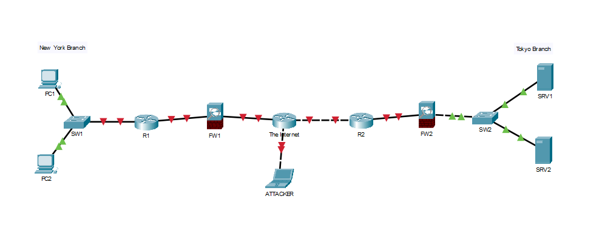

## 🔹 Lab 01 - Packet Tracer Introduction

This lab demonstrates a network topology designed to connect two branch networks over the Internet, using firewalls to provide network security and protect against potential threats.

